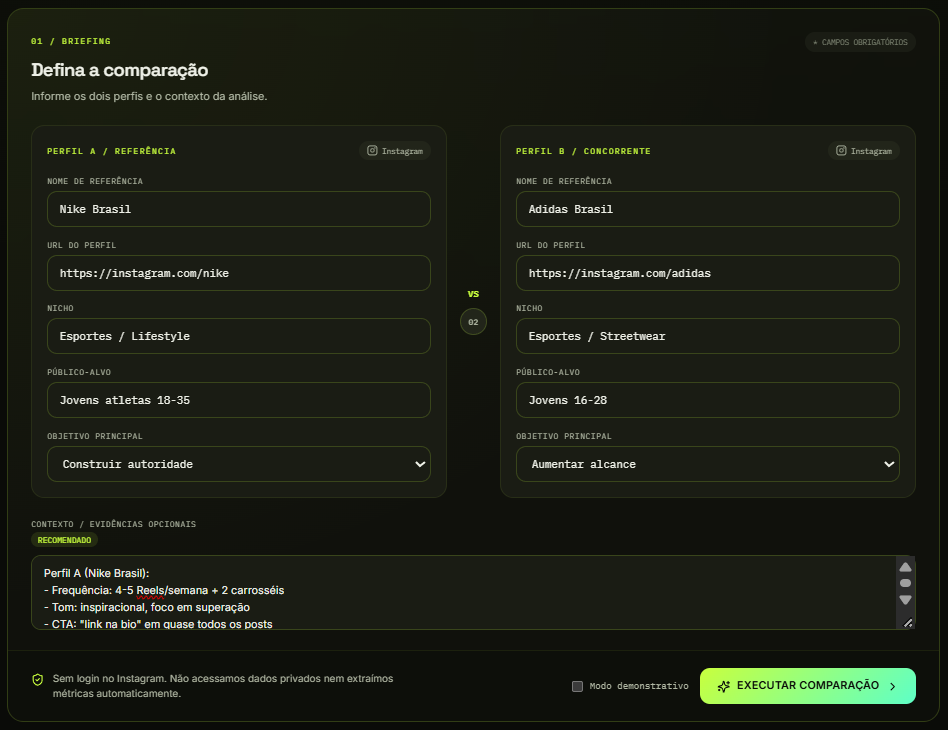
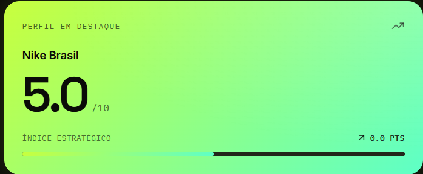
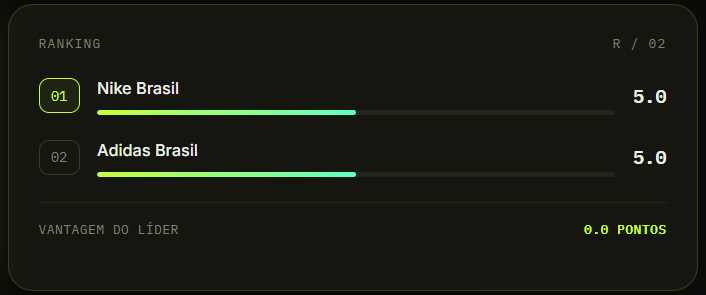
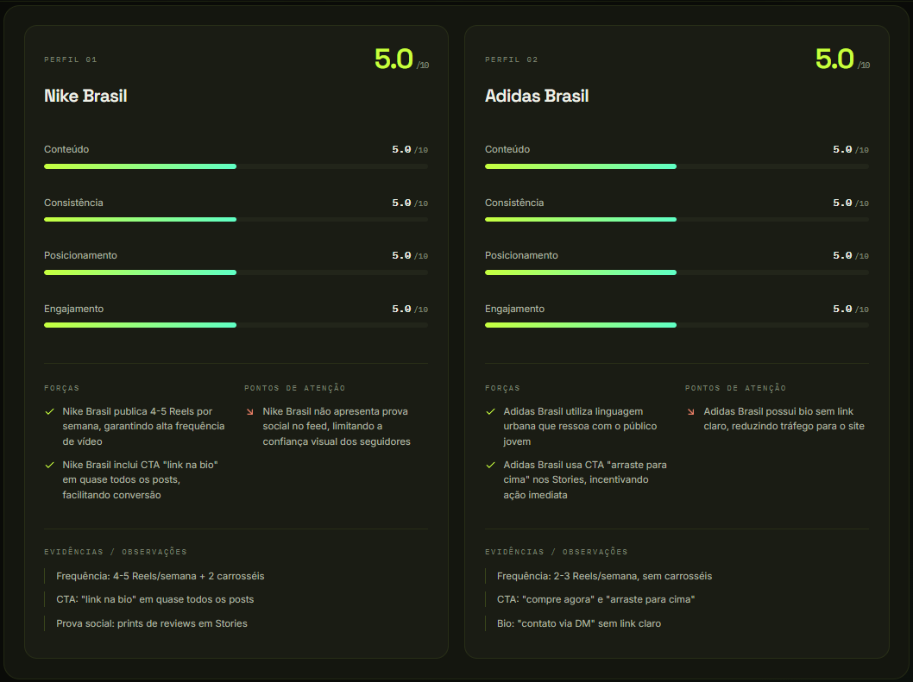
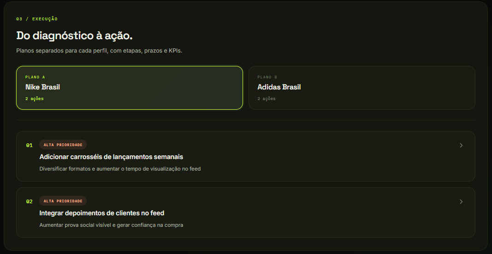

# Signal Grid

> Inteligência competitiva para Instagram — MVP que analisa um perfil individualmente ou compara dois perfis, gerando diagnóstico estratégico com plano de ação detalhado.


---

## 📖 Sobre

**Signal Grid** é uma ferramenta para agências e profissionais de social media que precisam analisar perfis do Instagram e transformar sinais em decisões estratégicas.

O sistema recebe um **briefing** (nome, URL, nicho, público e evidências) e usa **IA** para gerar:

- **Diagnóstico completo** — notas em 4 pilares (Conteúdo, Consistência, Posicionamento, Engajamento)
- **Ranking comparativo** (no modo de comparação)
- **Oportunidades prioritárias** com impacto estimado
- **Plano de ação** — específico por perfil no modo de comparação
- **Exportação em PDF** do relatório completo

---

## ✨ Screenshots

### Briefing — defina os perfis



### Visão geral — diagnóstico e ranking



### Comparação de perfis — análise detalhada



### Plano de ação — tabs por perfil



### Modo de análise única — 1 perfil



---

## 🎯 Modos de análise

### Análise Única

Diagnóstico completo de **um perfil**: forças, fraquezas, oportunidades e plano de ação específico.

### Comparação

Compara **dois perfis** lado a lado:

- Ranking com vantagem do líder
- Comparativo de pilares
- **Plano de ação separado** para cada perfil (com tabs)

Use o **toggle no topo** para alternar entre os modos.

---

## 🚀 Começando

### Pré-requisitos

- **Node.js 20 ou superior** — [baixar](https://nodejs.org/)
- **Conta em um provider de IA** (recomendado: **Groq** — grátis)

### Instalação

```bash
# 1. Clone o repositório
git clone https://github.com/juanp7tj/signal-grid.git
cd signal-grid

# 2. Instale as dependências
npm install

# 3. Copie o arquivo de variáveis de ambiente
# Windows (PowerShell):
Copy-Item .env.example .env
# Linux/Mac:
cp .env.example .env

# 4. Edite o .env e configure seu provider (veja abaixo)

# 5. Inicie o servidor de desenvolvimento
npm run dev


🔑 Configurando o provider de IA
Opção 1 — Groq (recomendado, gratuito)
Crie uma conta em console.groq.com

Vá em API Keys e gere uma nova

Copie a chave (gsk_...)

Edite o .env:

bash
PORT=3000
AI_PROVIDER=openai-compatible

OPENAI_BASE_URL=https://api.groq.com/openai
OPENAI_API_KEY=gsk_sua-chave-aqui
OPENAI_MODEL=openai/gpt-oss-120b

REQUEST_TIMEOUT_MS=300000
Opção 2 — DeepSeek (pago, alta qualidade)
Adicione crédito em platform.deepseek.com/top_up (mínimo $2)

Gere uma chave em platform.deepseek.com/api_keys

Edite o .env:

bash
PORT=3000
AI_PROVIDER=openai-compatible

OPENAI_BASE_URL=https://api.deepseek.com
OPENAI_API_KEY=sk_sua-chave-aqui
OPENAI_MODEL=deepseek-v4-pro

REQUEST_TIMEOUT_MS=300000
Opção 3 — Ollama (local, privado, grátis)
Instale o Ollama

Baixe um modelo:

bash
ollama pull qwen2.5:1.5b
Edite o .env:

bash
PORT=3000
AI_PROVIDER=ollama

OLLAMA_BASE_URL=http://127.0.0.1:11434
OLLAMA_MODEL=qwen2.5:1.5b

REQUEST_TIMEOUT_MS=600000
Nota: modelos locais são mais lentos e menos precisos, mas 100% privados.

🏗️ Arquitetura
text
signal-grid/
├── server/
│   └── index.ts          # Express + API de análise (single + compare)
├── src/
│   ├── App.tsx           # Componente principal (com toggle de modo)
│   ├── main.tsx          # Entry point
│   ├── styles.css        # Design system completo
│   └── types.ts          # Tipos compartilhados
├── public/
│   ├── favicon.svg       # Favicon personalizado //SG
│   └── apple-touch-icon.svg
├── docs/                 # Screenshots para o README
├── index.html
├── vite.config.ts        # Config do Vite + proxy /api
├── tsconfig.json         # TS do frontend
├── tsconfig.server.json  # TS do backend
└── package.json
Stack:

Frontend: React 18 + TypeScript + Vite + Lucide Icons

Backend: Node.js + Express + TypeScript

IA: Groq / DeepSeek / OpenAI / Ollama (qualquer endpoint OpenAI-compatible)

🎯 Como usar
Escolha o modo no toggle do topo:

Análise Única — 1 perfil

Comparação — 2 perfis

Preencha o briefing:

Nome de referência

URL do perfil (Instagram)

Nicho

Público-alvo

Objetivo principal

Adicione evidências (fortemente recomendado):

Frequência de publicação

Formatos usados (Reels, Carrossel, Stories)

Tom de voz

CTAs observados

Prova social

Bio do perfil

Clique em EXECUTAR e aguarde o diagnóstico.

Explore as abas:

Visão geral — destaque, ranking, pilares, oportunidades

Comparar perfis — análise detalhada lado a lado

Plano de ação — plano único (single) ou tabs A/B (compare)

Exporte em PDF clicando em EXPORTAR PDF.

⚠️ Limitações e segurança
Não faz scraping do Instagram. As URLs servem apenas como referência textual.

Não acessa dados privados. A análise depende exclusivamente das evidências que você fornecer.

Notas são estimativas qualitativas. Não substituem métricas oficiais do Instagram.

Sua chave de API nunca é exposta ao frontend. Todas as chamadas à IA acontecem no backend.

O .env está no .gitignore. Nunca commite sua chave de API.

🛠️ Scripts disponíveis
Comando	Descrição
npm run dev	Inicia backend + frontend em modo desenvolvimento
npm run build	Compila o frontend e o backend para produção
npm start	Roda o build de produção
npm run typecheck	Verifica erros de TypeScript
🤝 Contribuições
Sugestões, issues e PRs são bem-vindos.

📄 Licença
MIT — sinta-se livre para usar, modificar e distribuir.
